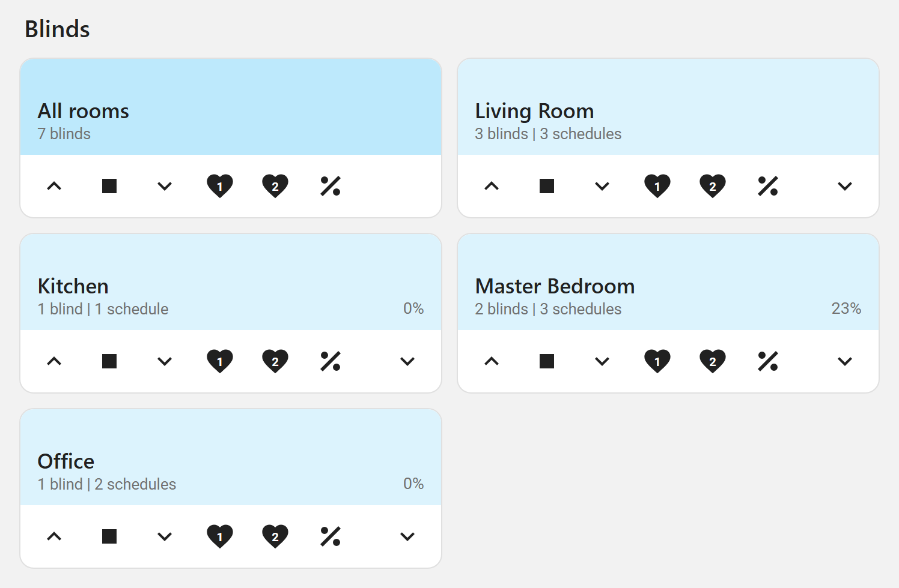
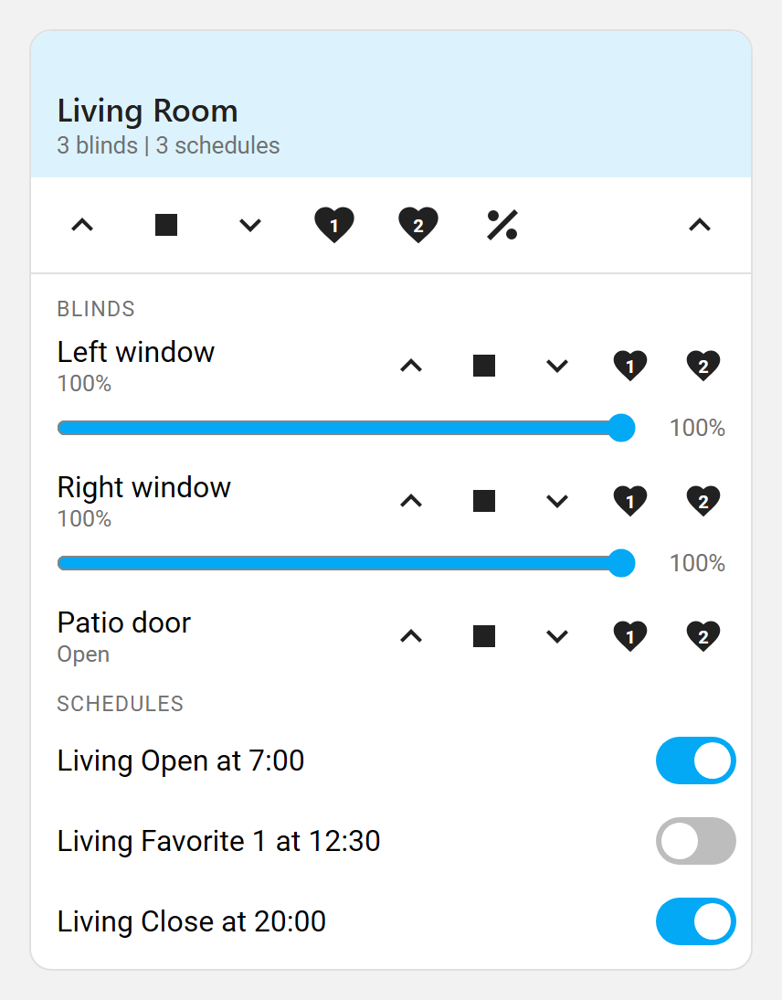
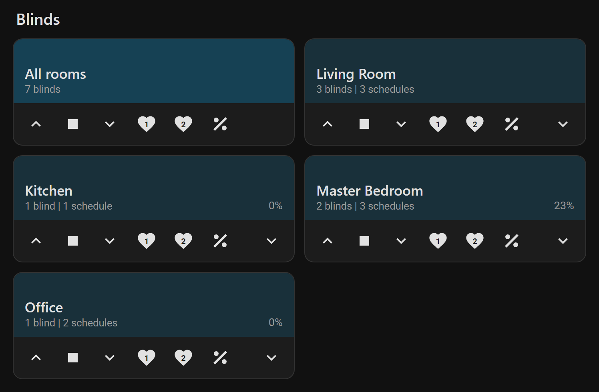
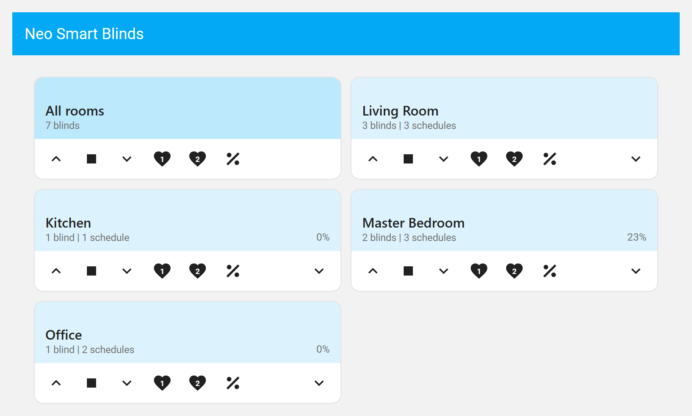

# Neo Smart Blinds (Cloud) Integration for Home Assistant

<!-- ha-marketplace:exclude-start -->
[](https://my.home-assistant.io/redirect/marketplace_repository/?owner=MrToast99&repository=NeoSmartBlinds_HA&category=integration)
<!-- ha-marketplace:exclude-end -->

Control your [Neo Smart Blinds](https://neosmartblinds.com/) from Home Assistant through the Neo cloud, the same service the Neo Smart Blinds app uses.

* **Covers:** every blind and every room, with open, close, stop and (where the motor supports it) a position.
* **Favorite buttons:** "Favorite 1" and "Favorite 2" for each blind and each room.
* **Schedule switches:** turn the schedules from the Neo app on or off.
* **Dashboard card and sidebar page:** room tiles laid out like the Neo app (see [Dashboard card](#dashboard-card)).



> **Cloud only.** This works only with blinds already set up in the Neo Smart Blinds app, and it needs an internet connection. There is no local control.

## Installation

Requires Home Assistant 2026.11 or newer.

### Marketplace (recommended)

This integration is not in the default catalog yet, so add it from its link:

1.  Click the badge above, or in Home Assistant open the **Marketplace** and choose **Add from link**. Paste this repository's URL and pick the category **Integration**.
2.  Install **Neo Smart Blinds (Cloud)**.
3.  Add the integration as described under [Configuration](#configuration). A first install needs no restart.

### Manual installation

1.  Copy the `neosmartblinds` folder from this repository's `custom_components` folder into your Home Assistant `custom_components` folder.
2.  Restart Home Assistant.

## Configuration

1.  Go to **Settings > Devices & Services** and click **Add Integration**.
2.  Search for **Neo Smart Blinds (Cloud)**.
3.  Enter the **Username (Email)** and **Password** you use in the Neo Smart Blinds app.
4.  Choose whether to **Show Neo Blinds in the sidebar** (on by default).

The integration signs in, finds your rooms, controllers, blinds and schedules, and creates the devices and entities for them. Your login is stored in Home Assistant's config entry so the integration can sign in again, and it is only sent to the Neo cloud.

### Options

Open the integration and choose **Configure** to change:

* **Show Neo Blinds in the sidebar:** adds or removes the sidebar page.
* **Debug Logging Level:** how much of the data sent to the Neo cloud is written to the debug log. The default is redacted. Choose full logging only while troubleshooting, and don't post those logs publicly, because they are not redacted.

Changing an option reloads the integration.

### Changing the login

* **You changed your Neo password:** Home Assistant asks for the new one, see [Troubleshooting](#troubleshooting).
* **You want to use a different email for the same Neo account:** open the integration, click the **⋮** menu next to the account, and choose **Reconfigure**. Enter the email and password. It has to be the same Neo account; to use a different account, add it as another one.

## What you get

| Device | Entities |
| --- | --- |
| **Account** | The top-level device for your login. |
| **Controller** (one per Neo controller) | Nothing of its own: it is the parent of its rooms and blinds. The Neo cloud doesn't name controllers, so it is named after one of the rooms it serves, for example "Neo Controller (Master)". One controller can serve several rooms. |
| **Room** (one per room, under its controller) | A cover for the whole room ("Room: Dining"), two favorite buttons ("Room: Dining Favorite 1"), and a switch for each of the room's schedules ("Room: Dining Open at 7:00"). |
| **Blind** (one per blind, under its room) | A cover, plus "Favorite 1" and "Favorite 2" buttons. |

* **Blind covers** are blind-type covers and support open, close and stop. A position slider is added for motors that report percent support.
* **Room covers** open, close or stop every blind in the room at once. They have no position of their own; use the blinds or the card's "set position" slider for that.
* **Favorite buttons** are created for every blind and room. They only do something on motors that have a favorite position set.
* **Schedule switches** are named from the room, action and time, for example "Room: Master Favorite 1 at 7:00". Turning one on or off enables or disables that schedule in the cloud.

### Actions

| Action | What it does |
| --- | --- |
| `neosmartblinds.favorite_1` | Moves the targeted blinds or room covers to their Favorite 1 position. |
| `neosmartblinds.favorite_2` | The same for Favorite 2. |

Target them at cover entities, for example:

```yaml
action: neosmartblinds.favorite_1
target:
  entity_id: cover.room_dining
```

The favorite buttons do the same thing and are easier to use in dashboards and automations (`button.press`). The usual cover actions (`cover.open_cover`, `cover.close_cover`, `cover.stop_cover`, `cover.set_cover_position`) work too.

If the Neo cloud doesn't accept a command, the action fails with an error message, so you see it in the interface and automations can react to it. For a room, every blind is tried, and the error says how many didn't respond.

### When the login stops working

If the Neo login is rejected, for example after a password change, every entity of that account shows as **unavailable** and Home Assistant asks you to sign in again (see [Troubleshooting](#troubleshooting)). Everything comes back once you do.

### Diagnostics

On the integration's page, **⋮ > Download diagnostics** saves a summary for bug reports: how many rooms, blinds and schedules there are, and which motor types the blinds report. It leaves out your email, password, tokens, controller IDs and every name.

### How state works

The Neo cloud doesn't report where a blind is, so Home Assistant only knows what it last told the blind to do. A blind moved with the remote or the Neo app won't update in Home Assistant, and the covers are marked as having an assumed state.

Rooms, blinds and schedules are read when the integration loads. If you add a blind or change a schedule in the Neo app, reload the integration (**Settings > Devices & Services > Neo Smart Blinds > ⋮ > Reload**) to pick it up.

## Dashboard card

The integration serves its own card and adds it to your dashboard resources, so there is nothing to copy or install. Add it from the card picker (**Neo Smart Blinds**) or in YAML:

```yaml
type: custom:neosmartblinds-card
title: Blinds              # optional
room: Master               # optional; leave out to list every room
show_all: true             # optional, an "All rooms" tile above the rooms
show_blinds: true          # optional, expandable list of each blind in a room
show_schedules: true       # optional, schedule switches inside a room
start_expanded: false      # optional, open every room's details at first
```

Each room tile has open, stop, close, Favorite 1, Favorite 2 and a "set position" slider for the whole room. Expand a room to control each blind on its own and to switch its schedules on or off.

| Expanded room | Dark theme |
| --- | --- |
|  |  |

The card follows your Home Assistant theme. The pictures show sample rooms and blinds, not a real account.

If your dashboards are in YAML mode, resources can't be written for you, so the card is loaded on every page instead.

### Sidebar page

The same card is also a page of its own in Home Assistant's sidebar, with no dashboard needed. It is on by default for new accounts. Accounts added before this option existed keep it off until you turn on **Show Neo Blinds in the sidebar** under **Configure**.



## Removing the integration

1.  Go to **Settings > Devices & Services** and open **Neo Smart Blinds (Cloud)**.
2.  Click the **⋮** menu next to the account and choose **Delete**.

This removes the account's devices and entities, its sidebar page, and the dashboard card's resource when it was the last account. Your Neo Smart Blinds app and its blinds are not touched. If you installed through the Marketplace, uninstall it there afterwards. For a manual install, delete the `neosmartblinds` folder from `custom_components` and restart Home Assistant. Cards you added to dashboards stay in their YAML until you delete them.

## Troubleshooting

* **Controls do nothing, or you see an error in the log:** check that the same action works in the Neo Smart Blinds app, then reload the integration.
* **The login fails:** use the email and password from the Neo Smart Blinds app.
* **You changed your Neo password:** Home Assistant shows a "Reconfigure" / "Re-authenticate" prompt on the integration (**Settings > Devices & Services**). Enter the new password there. There is no need to remove the integration, and your entities and dashboards stay as they are. The password has to belong to the same Neo account.
* **The card says the integration isn't loaded:** the integration failed to start. Check **Settings > System > Logs** for `neosmartblinds`.
* **A bug or a question:** [open an issue](https://github.com/MrToast99/NeoSmartBlinds_HA/issues) and include the Home Assistant version, the integration version and the relevant log lines.

## Credits

* Original code by [@MrToast99](https://github.com/MrToast99).
* Released under the [MIT License](LICENSE).
* This is an unofficial, community-made integration. It is not affiliated with, endorsed by or supported by Neo Smart Blinds. The Neo Smart Blinds name and logo are trademarks of their owner and are used here only to identify the product this integration works with.
